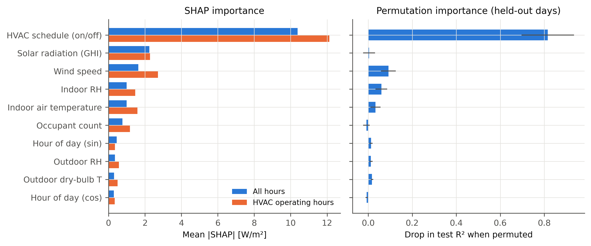

# AI-OBEP-MLPaper — surrogate teroptimasi metaheuristik + NSGA-II (setpoint ≥ 24 °C, PMV)

Pengembangan dari **Lyu et al. (2025)**, *A data-driven multi-objective optimisation framework for energy efficiency and thermal comfort in flexible building spaces*, Energy & Buildings 346, 116100 — **tanpa implementasi hardware**. Tiga hal saja yang dikerjakan:

1. **Surrogate akurat** — model energi HVAC per ruangan dari dataset ROBOD, akurasi setara/di atas paper.
2. **Metaheuristik (PSO, GA, HHO)** — dipasang ke *surrogate* (tuning hyperparameter XGBoost) **dan** ke *NSGA-II* (tuning hyperparameter algoritmanya).
3. **NSGA-II akurat** — objektif energi dengan setpoint ≥ 24 °C (kebijakan Malaysia) dan kenyamanan PMV; akurasi diukur terhadap *reference front*.

Plus **feature importance** (SHAP + permutation).

## Ringkasan hasil

| | Hasil | Pembanding |
|---|---|---|
| Surrogate, protokol paper (12 hari, 5 menit) | **R² = 0,949**, MAPE 11,0 % (XGBoost-PSO) | Lyu et al.: R² 0,933, MAPE 26,1 % |
| Surrogate, protokol ketat (hari utuh di-*hold-out*, per jam) | **R² = 0,941**, CV(RMSE) 27,3 %, NMBE −4,1 % | ASHRAE Guideline 14 (per jam): CV(RMSE) ≤ 30 %, NMBE ≤ ±10 % → **lolos** |
| Efek tuning PSO pada surrogate (CV 24 hari) | RMSE 46,3 → **36,4 W/m²** (−21 %), R² 0,904 → 0,940 | PSO > HHO ≈ GA |
| NSGA-II, hiperparameter paper | 96,2 % / 95,6 % HV *reference front* (kasus 1 / 2) | — |
| NSGA-II, hiperparameter hasil tuning metaheuristik | **98,0–99,3 %** HV *reference front* (terbaik: GA-tuned kasus 1, PSO-tuned kasus 2) | p < 0,001 (Mann–Whitney, 30 seed) |
| Penghematan energi vs layout awal @24 °C, semua penghuni \|PMV\| ≤ 0,5 | **18,3 % / 26,3 %** (solusi C) | paper: ≈ 10–12 % (tanpa setpoint) |
| …di antaranya kontribusi dinding bergerak saja (tanpa ubah setpoint) | 1,1 % / 6,4 % | paper: 11,7 % / 12,0 % |

## Cara menjalankan

```bash
cd AI-OBEP-MLPaper
pip install -r requirements.txt
bash scripts/00_get_data.sh            # ROBOD dari github.com/ideas-lab-nus/robod -> data/raw (tidak di-commit)
bash scripts/run_all.sh                # seluruh pipeline, ±2–3 jam di 2 core
```

| Skrip | Isi | Output |
|---|---|---|
| `01_surrogate_baseline.py` | ablasi langkah data, model zoo default, replikasi protokol paper | `outputs/surrogate/ablation_data_steps.csv`, `baseline_zoo_test_metrics.csv`, `paper_protocol_metrics.csv` |
| `02_tune_surrogate.py` | PSO / GA / HHO men-tuning XGBoost (3 seed × 200 evaluasi, budget sama) | `metaheuristic_*.csv`, `best_xgb_params.json` |
| `02b_tune_paper_protocol.py` | PSO / GA / HHO pada protokol persis paper | `paper_protocol_tuned.csv` |
| `03_final_surrogate.py` | pemilihan surrogate (hanya dari CV hari training) + simpan model | `final_surrogate_comparison.csv`, `outputs/models/surrogate.joblib` |
| `04_feature_importance.py` | SHAP + permutation importance | `outputs/importance/feature_importance.csv` |
| `05_tune_nsga2.py` | PSO / GA / HHO men-tuning hiperparameter NSGA-II | `outputs/nsga2/nsga2_tuned_hyperparameters.json` |
| `06_run_nsga2.py` | 30 seed × 25.000 evaluasi per konfigurasi, reference front, HV/IGD+, solusi A/B/C | `outputs/nsga2/*`, `outputs/figures/*` |
| `07_decomposition.py` | kontribusi dinding vs setpoint | `outputs/nsga2/decomposition.csv` |

Kode inti ada di `src/obep_mlpaper/` (`data`, `surrogate`, `metaheuristics`, `layout`, `nsga`, `comfort`).

---

## 1. Data dan protokol

- **Dataset**: ROBOD (Tekler et al., 2022), gedung SDE4 NUS Singapura, interval 5 menit. Sesuai paper dipakai **office-1 = ROBOD Room 3** (kantor admin, 98,4 m², 29 hari kerja).
- **Fitur** (7 dari paper, Sec. 3.2): suhu & RH dalam, jumlah penghuni, suhu luar, RH luar, kecepatan angin, radiasi surya.
- **Target**: energi HVAC = ceiling fan + chilled water + fan AHU.
- **Dua protokol evaluasi**:
  - *Protokol paper* — 12 hari kerja pertama, 5 menit, outlier dihaluskan, split acak baris 70/15/15 (default AutoGluon). Untuk dibandingkan langsung dengan Tabel 1 paper.
  - *Protokol ketat (dipakai untuk optimasi)* — semua 29 hari, per jam, **5 hari utuh di-hold-out** sebagai test, tuning memakai 5-fold *grouped CV* per hari. Split acak baris pada data 5 menit membocorkan informasi (sampel bertetangga hampir identik), jadi angka protokol paper cenderung optimistis.

## 2. Surrogate model

### 2.1 Langkah perbaikan akurasi (ablasi, test = hari yang di-hold-out)

Model lama di repo ini (R3+R4 digabung) hanya R² ≈ 0,47. Mengikuti paper dan praktik umum pemodelan energi gedung, perbaikan dilakukan bertahap:

| Langkah | ExtraTrees R² | XGBoost R² | CV(RMSE) XGB |
|---|---|---|---|
| 1. Data mentah 5 menit, 7 fitur paper | 0,821 | 0,813 | 50,9 % |
| 2. + penghalusan outlier (Hampel → rata-rata titik tetangga, seperti paper) | 0,847 | 0,839 | 46,6 % |
| 3. + agregasi per jam (meredam *cycling* katup chilled water) | 0,907 | 0,880 | 38,9 % |
| 4. + fitur jam (sin/cos) & jadwal HVAC on/off | 0,939 | 0,942 | 27,1 % |
| 5. + tuning hyperparameter metaheuristik (PSO) | — | 0,940 | 27,5 % |
| 6. + *monotone constraint* fisik | — | 0,941 | 27,3 % |

Langkah 6: energi dipaksa tidak turun saat penghuni, suhu luar, atau radiasi surya naik. Tujuannya agar NSGA-II tidak "mengeksploitasi" lekukan non-fisik surrogate. Biayanya hanya +0,2 % CV-RMSE.

Langkah 4 adalah lompatan terbesar: tanpa informasi jadwal, model harus menebak apakah HVAC sedang menyala dari fitur cuaca/okupansi saja.

Model zoo default pada protokol ketat (`baseline_zoo_test_metrics.csv`): MLP 0,947, LightGBM 0,944, XGBoost 0,942, RandomForest 0,942, ExtraTrees 0,939, KNN 0,929, Ridge 0,929, WeightedEnsemble 0,948.

### 2.2 Metaheuristik untuk tuning surrogate (PSO, GA, HHO)

Ketiga algoritma ditulis sendiri (`src/obep_mlpaper/metaheuristics.py`) dengan **budget evaluasi yang sama** (200 evaluasi, populasi 15, 3 seed):
- PSO: Kennedy & Eberhart (1995), inertia menurun linear.
- GA: real-coded, tournament + SBX + mutasi Gaussian + elitisme.
- HHO: Heidari et al. (2019), lengkap dengan soft/hard besiege & rapid dives.

Ruang pencarian: 9 hyperparameter XGBoost (jumlah pohon, learning rate, depth, min child weight, subsample, colsample, gamma, L1, L2). Fitness = RMSE 5-fold grouped CV pada hari training.

| Algoritma | CV-RMSE rata-rata ± sd [W/m²] | CV-RMSE terbaik | R² test rata-rata |
|---|---|---|---|
| **PSO** | **36,66 ± 0,36** | **36,43** | **0,939** |
| HHO | 37,21 ± 0,32 | 36,89 | 0,935 |
| GA | 37,25 ± 0,32 | 36,95 | 0,933 |
| XGBoost default | 46,29 | — | 0,942 |

Kurva konvergensi: `outputs/figures/fig_metaheuristic_convergence.png`. Ketiganya jauh di bawah default dalam ±25 evaluasi; PSO paling konsisten.

Catatan jujur: pada 5 hari test, semua model ≈ 0,94 sehingga tidak bisa dibedakan. Bukti perbaikan tuning ada pada CV 24 hari, yang jauh lebih stabil.

### 2.3 Hasil akhir vs paper

**Surrogate terpasang:** XGBoost-PSO + monotone (`outputs/models/surrogate.joblib`)
- Test (5 hari hold-out): R² **0,941**, CV(RMSE) **27,3 %**, NMBE **−4,1 %**, MAPE 16,1 %.
- Grouped-CV (24 hari): R² 0,940.

Protokol persis paper (`paper_protocol_metrics.csv`, `paper_protocol_tuned.csv`; tuning: 100 evaluasi, fitness = RMSE validasi 15 %, test 15 % tidak dipakai saat tuning). PSO menurunkan RMSE validasi 0,409 → 0,330 kWh/5 menit (−19 %):

| Model | R² | MAPE % |
|---|---|---|
| ExtraTrees (default) | 0,954 | 10,5 |
| WeightedEnsemble_L2 (sklearn, analog AutoGluon) | 0,949 | 11,7 |
| XGBoost (default) | 0,946 | 11,6 |
| **XGBoost-PSO** (tuning pada protokol ini, rata-rata 2 seed) | **0,949** | **11,0** |
| XGBoost-HHO | 0,947 | 11,5 |
| XGBoost-GA | 0,947 | 11,4 |
| **Lyu et al. — AutoGluon WeightedEnsemble_L2** | 0,933 | 26,1 |
| Lyu et al. — LSTM | 0,921 | 19,4 |

Batasan surrogate (perlu disebut di paper): R² **di dalam jam operasional saja** jauh lebih rendah (≈ 0,45–0,53). Sebagian besar R² keseluruhan berasal dari pembeda HVAC on/off. Variasi energi saat HVAC menyala ditentukan juga oleh hal yang tidak ada di 7 fitur, misalnya beban AHU bersama dan kontrol katup.

## 3. Feature importance



| Fitur | SHAP share | Permutation (drop R²) |
|---|---|---|
| Jadwal HVAC (on/off) | 64,2 % | 1,014 |
| Jumlah penghuni | 6,0 % | 0,022 |
| Radiasi surya | 5,9 % | 0,007 |
| Jam (cos) | 5,8 % | 0,043 |
| Kecepatan angin | 4,3 % | 0,003 |
| RH luar | 3,8 % | 0,016 |
| RH dalam | 3,1 % | 0,019 |
| Suhu luar | 3,0 % | −0,002 |
| Suhu dalam | 2,5 % | 0,022 |
| Jam (sin) | 1,4 % | 0,008 |

Dari 7 fitur paper, **jumlah penghuni** dan **radiasi surya** paling berpengaruh. Arah efek (beeswarm `fig_shap_beeswarm.png`) masuk akal secara fisik:
- penghuni ↑ → energi ↑
- radiasi ↑ → energi ↑
- RH dalam ↑ → energi ↓ (AC yang bekerja keras sekaligus mengeringkan udara)

## 4. Formulasi optimasi

Model matematika paper (Alg. 2–6, Eq. 10–12) dipertahankan: posisi dinding, aturan update luas/penghuni/suhu-RH, constraint luas minimum dan semua penghuni tertampung, mutasi wall-reordering, populasi awal = layout eksisting. Perubahannya:

**Variabel keputusan tambahan — setpoint tiap zona, 24 ≤ T_set ≤ 27 °C.**
- Batas bawah 24 °C mengikuti kebijakan pemerintah Malaysia: AC kantor pemerintah 24–25 °C (KASA, Agustus 2023), dipertegas "tidak lebih rendah dari 24 °C" (DPM Fadillah Yusof, April 2026).
- Baseline = layout awal dengan semua zona 24 °C.
- Suhu ruangan = rata-rata tertimbang overlap dari setpoint zona (Alg. 5).

**Objektif 1 — energi** f_cost = Σ q_j · A_j · φ(T_j) [kW]
- q_j = prediksi surrogate [W/m²].
- φ(T) = 1 − β (T − T_ref), dengan β = 9,6 %/°C (Hoyt et al., 2015: menaikkan setpoint 22,2 → 25 °C menghemat 27 % energi HVAC) dan T_ref = 27,4 °C.
- **Kenapa perlu koreksi ini:** di ROBOD office-1 setpoint tercatat konstan 25 °C, jadi data tidak bisa mengajari model efek perubahan setpoint. Suhu dalam yang terukur justru *hasil* dari beban, sehingga berkorelasi positif dengan energi. Surrogate karena itu ditanya pada T_ref, lalu efek setpoint diterapkan secara fisik.
- Penghuni diubah ke kepadatan setara office-1 (orang/m² × 98,4) agar surrogate yang dilatih di ruangan 98,4 m² berlaku untuk ruangan berbagai ukuran.

**Objektif 2 — kenyamanan** f_tc = rata-rata |PMV| tertimbang penghuni (ISO 7730), Eq. 11 paper, dengan v = 0,1 m/s, 1,0 met, 0,5 clo.

Kondisi luar sama dengan paper (27,5 °C, 85 %, 650 W/m², 1 m/s), snapshot pukul 14:30.

## 5. NSGA-II

### 5.1 Metaheuristik untuk tuning NSGA-II

Paper memakai Optuna; di sini PSO, GA, HHO.
- Ruang pencarian: ukuran populasi 10–100, p_mutasi, η_m (sd mutasi dinding, m), p_crossover, σ_T (sd mutasi setpoint).
- Fitness = HV ternormalisasi rata-rata 3 seed tuning (101–103, **terpisah** dari seed akhir 1–30) pada **budget evaluasi tetap** 3.000, agar populasi besar tidak menang hanya karena mendapat evaluasi lebih banyak.
- Setiap metaheuristik: 50 evaluasi × 2 seed per kasus.

| HV saat tuning (mean ± sd, 2 seed) | PSO | GA | HHO |
|---|---|---|---|
| Kasus 1 | 0,9994 ± 0,0007 | 0,9985 ± 0,0040 | **1,0038 ± 0,0010** |
| Kasus 2 | 1,0913 ± 0,0089 | 1,0888 ± 0,0149 | **1,0995 ± 0,0084** |

### 5.2 Akurasi NSGA-II (30 seed × 25.000 evaluasi = 500 generasi × 50 seperti paper)

*Reference front* = gabungan non-dominated dari 5 run panjang (populasi 200, 200.000 evaluasi) + semua front akhir.
- **HV ratio** = HV run / HV reference (1 = mencapai front terbaik).
- **IGD+** = jarak ke reference front (0 = mencapainya).
- Reference point HV = (1,5; 1,5) pada objektif ternormalisasi baseline.

Semua run deterministik per seed (mutasi memakai `random_state` pymoo), sehingga tabel ini bisa direproduksi persis.

| Kasus | Konfigurasi | HV ratio (mean / min) | IGD+ (mean) | Jumlah solusi | p vs paper |
|---|---|---|---|---|---|
| 1 | Hiperparameter paper (Tabel 3) | 0,962 / 0,948 | 0,0109 | 30 | — |
| 1 | PSO-tuned | 0,992 / 0,986 | 0,0039 | 49 | < 0,001 |
| 1 | **GA-tuned** | **0,993** / 0,986 | **0,0037** | 36 | < 0,001 |
| 1 | HHO-tuned | 0,990 / 0,984 | 0,0058 | 21 | < 0,001 |
| 2 | Hiperparameter paper (Tabel 6) | 0,956 / 0,946 | 0,0173 | 37 | — |
| 2 | **PSO-tuned** | **0,983** / 0,959 | 0,0154 | 12 | < 0,001 |
| 2 | GA-tuned | 0,980 / 0,961 | 0,0181 | 10 | < 0,001 |
| 2 | HHO-tuned | 0,982 / **0,970** | **0,0151** | 12 | < 0,001 |

**Kesimpulan:**
- NSGA-II hasil tuning mencapai **98–99 %** HV front terbaik yang diketahui, dibanding ≈ 96 % dengan hiperparameter paper (signifikan di kedua kasus).
- Ketiga metaheuristik setara; tidak ada pemenang tunggal. HHO paling stabil saat proses tuning, sementara GA/PSO terbaik pada evaluasi akhir.
- Konvergensi: `fig_case*_hv_convergence.png`.

**Catatan jujur untuk kasus 2:** tuning pada budget pendek (3.000 evaluasi) memilih populasi kecil (10–20). Hasilnya front konvergen (HV naik) tetapi lebih jarang (10–12 solusi), sehingga IGD+ hanya sedikit lebih baik daripada hiperparameter paper (GA-tuned bahkan sedikit lebih buruk). Bila sebaran solusi penting, gunakan fitness HV + IGD+ atau batas bawah populasi.

### 5.3 Solusi

A dan B diambil dari reference front. C = energi terendah di antara semua solusi akhir yang membuat **setiap** penghuni \|PMV\| ≤ 0,5 (ISO 7730 kategori B).

| Kasus | Solusi | Energi [kW] | Hemat | f_tc | Komfort ↑ | Setpoint zona [°C] | \|PMV\| terburuk |
|---|---|---|---|---|---|---|---|
| 1 | Baseline @24 °C | 43,67 | — | 0,497 | — | 24 | 0,53 |
| 1 | A — energi minimum | 33,79 | 22,6 % | 0,661 | −33,0 % | semua 27 | 0,71 |
| 1 | B — komfort terbaik | 38,68 | 11,4 % | 0,000 | +100 % | 25,2–25,4 (rapat 27) | 0,00 |
| 1 | **C — energi min. dgn semua \|PMV\| ≤ 0,5** | 35,69 | **18,3 %** | 0,402 | +19,1 % | 26,0–27 | 0,44 |
| 2 | Baseline @24 °C | 65,04 | — | 0,642 | — | 24 | 0,71 |
| 2 | A — energi minimum | 47,26 | 27,3 % | 0,482 | +25,0 % | semua 27 | 0,56 |
| 2 | B — komfort terbaik | 55,89 | 14,1 % | 0,000 | +100 % | 25,0–26,1 | 0,00 |
| 2 | **C — energi min. dgn semua \|PMV\| ≤ 0,5** | 47,91 | **26,3 %** | 0,431 | +32,8 % | 26,5–27 | 0,50 |

Detail tata letak & setpoint: `outputs/nsga2/case*_summary.json`, gambar `fig_case*_layouts.png`, Pareto `fig_case*_pareto.png`.

### 5.4 Dari mana penghematannya? (dinding vs setpoint, `07_decomposition.py`, 10 seed per varian)

| Kasus | Hanya setpoint | Hanya dinding (24 °C) | Dinding + setpoint |
|---|---|---|---|
| 1 — hemat maks. | 21,8 % | 1,1 % | 22,6 % |
| 1 — hemat dgn semua \|PMV\| ≤ 0,5 | 16,5 % | tidak ada solusi | 16,5 % |
| 2 — hemat maks. | 21,8 % | 6,4 % | 27,3 % |
| 2 — hemat dgn semua \|PMV\| ≤ 0,5 | 17,6 % | tidak ada solusi | **24,4 %** |

Angka 5.4 berasal dari 10 seed per varian; 5.3 memakai 120 run sehingga sedikit lebih tinggi.

**Interpretasi untuk paper:**
- Sebagian besar penghematan berasal dari menaikkan setpoint di atas 24 °C, dan besarnya bergantung pada asumsi β.
- Dinding bergerak menambah **+6,8 poin** di kasus 2 (Watson, ruangan tidak seragam) saat kenyamanan dijaga, tetapi hampir nol di kasus 1 (ruangan seragam).
- Dengan surrogate berbasis kepadatan penghuni, kontribusi dinding saja (1,1 % / 6,4 %) lebih kecil daripada di paper (≈ 11–12 %). Paper memakai jumlah orang absolut sehingga ruangan kecil dan besar dengan jumlah orang sama dianggap berintensitas sama.
- Pada 24 °C dengan 0,5 clo, PMV ≈ −0,5 s/d −0,7 (agak dingin), sehingga tidak ada layout yang membuat semua penghuni \|PMV\| ≤ 0,5. Optimum komfort ada di 25,0–26 °C. Ini sejalan dengan semangat kebijakan Malaysia (≥ 24 °C, pakaian ringan/batik).

## 6. Asumsi dan keterbatasan

- **β = 9,6 %/°C** diambil dari literatur (Hoyt et al., 2015, rata-rata beberapa iklim), bukan dari data ROBOD. Angka hemat yang berasal dari setpoint sebaiknya disertai uji sensitivitas β bila reviewer meminta. Kontribusi dinding (5.4, kolom "hanya dinding") tidak terpengaruh β.
- RH zona kasus 1 (80–89 %) di luar rentang training (54–71 %), sehingga pohon keputusan saturasi pada batas. Ini sama dengan paper yang memakai nilai Tabel 2.
- Daya per m² office-1 tinggi (≈ 300 W/m² saat operasi) karena meter chilled water mencakup beban AHU. Karena itu hasil dilaporkan relatif terhadap baseline.
- Bobot ruangan w_j = 1, kedalaman B = 4 m (kasus 1) / 3 m (kasus 2), satu snapshot waktu (seperti paper).
- R-NSGA-II, NSGA-III, SMS-EMOA dari paper tidak diulang, karena fokus hanya NSGA-II.

## Referensi

- Lyu, H. et al. (2025). A data-driven multi-objective optimisation framework for energy efficiency and thermal comfort in flexible building spaces. *Energy and Buildings* 346, 116100. https://doi.org/10.1016/j.enbuild.2025.116100
- Tekler, Z. D. et al. (2022). ROBOD, room-level occupancy and building operation dataset. *Building Simulation* 15, 2127–2137. Data: https://github.com/ideas-lab-nus/robod
- Hoyt, T., Arens, E., Zhang, H. (2015). Extending air temperature setpoints: simulated energy savings and design considerations for new and retrofit buildings. *Building and Environment* 88, 89–96. https://doi.org/10.1016/j.buildenv.2014.09.010
- Kennedy, J., Eberhart, R. (1995). Particle swarm optimization. *Proc. ICNN'95*.
- Heidari, A. A. et al. (2019). Harris hawks optimization: algorithm and applications. *Future Generation Computer Systems* 97, 849–872.
- Deb, K. et al. (2002). A fast and elitist multiobjective genetic algorithm: NSGA-II. *IEEE TEVC* 6(2), 182–197.
- Ishibuchi, H. et al. (2015). Modified distance calculation in generational distance and inverted generational distance (IGD+). *EMO 2015*.
- Lundberg, S. M., Lee, S.-I. (2017). A unified approach to interpreting model predictions (SHAP). *NeurIPS*.
- ISO 7730:2005; ASHRAE Guideline 14-2014 (kriteria CV(RMSE)/NMBE per jam).
- Kebijakan Malaysia: [BenarNews, Agustus 2023](https://www.benarnews.org/english/news/malaysian/environment-batik-acs-govt-buildings-08232023091339.html); [Daily Express via TNB, 3 April 2026](https://www.tnb.com.my/assets/newsclip/03042026b1.pdf).
