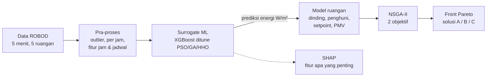

# Memahami ML di AI-OBEP

Panduan ini menjelaskan **apa yang dikerjakan model ML di repo ini, kenapa, dan di file mana**,
tanpa mengasumsikan latar belakang data science. Angka hasil lengkap ada di
[`AI-OBEP-MLPaper/README.md`](../AI-OBEP-MLPaper/README.md).

## Gambaran besar dalam satu kalimat

> Kita melatih model ML yang bisa **menebak energi HVAC sebuah ruangan** dari kondisi ruangan & cuaca
> (*surrogate*), lalu memakai algoritma evolusi (**NSGA-II**) untuk mencari **posisi dinding bergerak dan
> setpoint AC** yang paling hemat energi **sekaligus** paling nyaman bagi penghuni.

Paper rujukan: **Lyu et al. (2025)**, *Energy and Buildings* 346, 116100. v1 (folder root) mereplikasi paper
apa adanya; v2 (`AI-OBEP-MLPaper/`) memperbaiki akurasi dan menambah setpoint ≥ 24 °C (kebijakan Malaysia).

---

## 1. Data: ROBOD

- 5 ruangan gedung SDE4 NUS (Singapura): 2 ruang kuliah, 2 kantor, 1 perpustakaan. Interval 5 menit, Sep–Des 2021.
- Isi per baris: suhu & RH dalam, jumlah orang (dihitung kamera), CO₂, Wi-Fi, cuaca luar, dan energi
  (kipas plafon, chilled water, kipas AHU/FCU).
- v2 memakai **Room 3** (kantor admin, 98,4 m²) = "office-1" di paper.

Temuan penting dari EDA (`notebooks/01_explore_dataset.ipynb`):
- Energi HVAC **mengikuti jadwal** (08:30–18:40), bukan jumlah orang → HVAC saat ini tidak responsif okupansi.
  Itulah celah yang ingin diisi AI-OBEP.
- Untuk sensor murah di lapangan, jumlah perangkat Wi-Fi paling berkorelasi dengan jumlah orang (r 0,52–0,89).

## 2. Surrogate model — inti ML-nya

### Apa itu surrogate?
Simulasi energi gedung "asli" (EnergyPlus dsb.) lambat. NSGA-II perlu mengevaluasi puluhan ribu layout.
Maka kita latih model ML yang **meniru** hubungan *kondisi → energi* dan bisa menjawab dalam mikrodetik.
Model peniru ini disebut *surrogate*.

### Input (fitur) dan output (target)

| | Isi |
|---|---|
| **7 fitur paper** | suhu dalam, RH dalam, jumlah penghuni, suhu luar, RH luar, kecepatan angin, radiasi surya |
| **+3 fitur v2** | jam (sin & cos — supaya 23:00 dan 00:00 "berdekatan"), jadwal HVAC on/off |
| **Target** | energi HVAC (kipas plafon + chilled water + kipas AHU), dalam W/m² |

File: `AI-OBEP-MLPaper/src/obep_mlpaper/data.py` (`FEATURES`, `TARGET`, `hourly_dataset`).

### Langkah perbaikan akurasi (v2)

| Langkah | Kenapa | R² (XGBoost) |
|---|---|---|
| Data mentah 5 menit | — | 0,81 |
| + haluskan outlier (Hampel) | lonjakan sesaat sensor energi | 0,84 |
| + agregasi per jam | katup chilled water on-off cepat (*cycling*) → noise | 0,88 |
| + fitur jam & jadwal | model tak perlu menebak "AC sedang nyala?" | **0,94** |

Pelajaran: **rekayasa fitur dan pembersihan data** memberi lompatan terbesar, bukan ganti algoritma.

### Model yang dicoba ("model zoo")
`surrogate.py → model_zoo()`: Ridge (linear), KNN, RandomForest, ExtraTrees, XGBoost, LightGBM, MLP (neural net),
plus **WeightedEnsemble** — gabungan berbobot beberapa model; bobot dicari dengan NNLS (kuadrat terkecil non-negatif)
dari prediksi *out-of-fold*, meniru AutoGluon yang dipakai paper.

Di data per jam yang sudah dirapikan, hampir semua model ≈ 0,93–0,95. Dipilih **XGBoost** karena
bisa diberi *monotone constraint* (lihat bawah) dan mudah di-tuning.

### Tuning hyperparameter dengan metaheuristik (PSO, GA, HHO)
XGBoost punya banyak "kenop" (jumlah pohon, learning rate, kedalaman, regularisasi…). Mencoba semua
kombinasi mustahil, jadi pencariannya diserahkan ke metaheuristik — ditulis sendiri di `metaheuristics.py`:

- **PSO** (Particle Swarm): kawanan partikel bergerak ke posisi terbaik pribadi & kawanan.
- **GA** (Genetic Algorithm): seleksi turnamen, crossover SBX, mutasi Gaussian, elitisme.
- **HHO** (Harris Hawks): meniru elang mengepung mangsa (eksplorasi → *besiege* → *dive*).

Fitness = RMSE **5-fold grouped CV per hari** (satu hari utuh tidak boleh terbelah antara train & validasi).
Ketiganya diberi budget sama (200 evaluasi) supaya adil. Hasil: PSO paling konsisten, RMSE turun ±21 %.

### Monotone constraint
Secara fisik energi **tidak boleh turun** saat penghuni, suhu luar, atau radiasi surya naik. XGBoost dipaksa
mematuhi ini (`monotone_constraints` di `scripts/03_final_surrogate.py`), supaya NSGA-II tidak "mengakali"
lekukan aneh model. Biayanya hampir nol (+0,2 % CV-RMSE).

### Cara evaluasi yang jujur
- **Jangan split acak per baris** pada data 5 menit: baris bertetangga hampir identik → bocor → R² terlalu optimistis.
  v2 menahan **5 hari utuh** sebagai data test.
- Metrik: **R²** (seberapa banyak variasi dijelaskan), **RMSE**, **CV(RMSE)** & **NMBE** (standar ASHRAE
  Guideline 14: per jam CV(RMSE) ≤ 30 %, NMBE ≤ ±10 %). Surrogate v2: 27,3 % dan −4,1 % → lolos.
- **Batasan yang harus disebut di paper:** R² di dalam jam operasional saja hanya ±0,5. Sebagian besar R²
  berasal dari membedakan HVAC on/off.

### Feature importance (SHAP)
`04_feature_importance`: SHAP mengukur kontribusi tiap fitur ke setiap prediksi. Jadwal HVAC mendominasi (64 %);
dari 7 fitur paper, **jumlah penghuni** dan **radiasi surya** paling berpengaruh, dan arahnya masuk akal
(penghuni ↑ → energi ↑).

## 3. Model ruangan & dua objektif

File: `AI-OBEP-MLPaper/src/obep_mlpaper/layout.py`.

**Variabel keputusan** (yang diubah-ubah optimizer):
- posisi tiap dinding bergerak (meter),
- setpoint AC tiap zona, 24–27 °C (v2).

**Aturan update** (Algoritma 3–5 paper): dari posisi dinding dihitung luas tiap ruangan → penghuni dipindah bila
ruangan kekecilan → suhu & RH ruangan = rata-rata tertimbang zona yang ditutupinya.

**Objektif 1 — energi** `f_cost` [kW]: surrogate memprediksi W/m² tiap ruangan × luas, dikoreksi efek setpoint
(±9,6 % per °C, dari literatur Hoyt et al. 2015, karena di data setpoint selalu 25 °C sehingga model tak bisa
mempelajarinya sendiri).

**Objektif 2 — kenyamanan** `f_tc`: rata-rata |PMV| per penghuni (ISO 7730, `comfort.py`). PMV 0 = netral,
±0,5 = batas nyaman kategori B, negatif = dingin.

**Constraint**: luas ruangan minimum dan semua penghuni harus kebagian tempat.

## 4. NSGA-II — mencari kompromi terbaik

Hemat energi dan nyaman **saling bertentangan** (AC lebih dingin = nyaman tapi boros). Tidak ada satu jawaban
terbaik; yang ada adalah **front Pareto** — kumpulan solusi di mana kamu tidak bisa memperbaiki satu objektif
tanpa memperburuk yang lain.

NSGA-II (`nsga.py`, pakai `pymoo`) bekerja seperti evolusi:
1. Populasi awal = layout eksisting (seperti paper).
2. Tiap generasi: crossover SBX + **mutasi khusus** (geser dinding Gaussian lalu urutkan ulang; geser setpoint).
3. Seleksi berdasarkan *non-dominated sorting* (siapa yang tidak kalah di dua objektif) + *crowding distance*
   (agar solusi tersebar merata).
4. Ulangi sampai budget evaluasi habis (25.000).

**Mengukur kualitas front:**
- **Hypervolume (HV)**: luas area yang "didominasi" front — makin besar makin baik.
- **IGD+**: jarak ke front terbaik yang diketahui (*reference front*) — makin kecil makin baik.
- Diulang **30 seed** dan diuji Mann–Whitney, karena algoritma evolusi bersifat acak.

Hyperparameter NSGA-II (ukuran populasi, peluang mutasi, dst.) juga di-tuning dengan PSO/GA/HHO
(`05_tune_nsga2`) → HV naik dari ±96 % ke 98–99 % reference front.

**Solusi yang dilaporkan:**
- **A** — energi minimum; **B** — kenyamanan terbaik;
- **C** — energi minimum dengan syarat **semua** penghuni |PMV| ≤ 0,5 → yang paling layak dipakai.
  Hemat 18,3 % (kasus 1) dan 26,3 % (kasus 2) dibanding layout awal @24 °C.

`07_decomposition` memisahkan sumber penghematan: sebagian besar dari menaikkan setpoint; dinding bergerak
menambah ±6,8 poin di kasus ruangan tidak seragam (Watson).

## 5. Peta file

| Ingin memahami… | Buka |
|---|---|
| Cara data dibaca & dibersihkan | `AI-OBEP-MLPaper/src/obep_mlpaper/data.py` |
| Model zoo, ensemble, kelas `Surrogate` | `…/surrogate.py` |
| PSO / GA / HHO | `…/metaheuristics.py` |
| Aturan dinding, penghuni, objektif | `…/layout.py` |
| PMV | `…/comfort.py` |
| NSGA-II, mutasi, HV/IGD+ | `…/nsga.py` |
| Versi replikasi awal (v1) | `src/aiobep/` + `notebooks/01–03` |

## 6. Urutan belajar yang disarankan

1. Jalankan `notebooks/01_explore_dataset.ipynb` → pahami datanya lewat grafik.
2. Baca `AI-OBEP-MLPaper/notebooks/01_surrogate_baseline.ipynb` → lihat efek tiap langkah pra-proses.
3. Coba demo di `colab_quickstart.ipynb` bagian 5 → ubah `n_evals`, `seed`, atau `case_study_2()` dan amati front Pareto.
4. Baca `04_feature_importance` → latih membaca grafik SHAP.
5. Baru masuk ke `05`–`07` untuk tuning dan hasil akhir.

**Eksperimen kecil yang aman dicoba:**
- Ganti `run_nsga2(..., n_evals=3000)` jadi 10.000 → apakah front makin bagus?
- Di `layout.py`, ubah `d_out` (cuaca luar) → bagaimana energi baseline berubah?
- Latih ulang surrogate tanpa fitur `hvac_schedule` → seberapa turun R²-nya? (menjelaskan kenapa jadwal penting)

## Glosarium singkat

| Istilah | Arti |
|---|---|
| Surrogate | model ML pengganti simulasi yang lambat |
| Hyperparameter | pengaturan model yang dipilih sebelum training (bukan dipelajari dari data) |
| Grouped CV | cross-validation yang menjaga satu hari tetap utuh di satu fold |
| R², RMSE | ukuran akurasi prediksi (R² mendekati 1 dan RMSE kecil = baik) |
| CV(RMSE), NMBE | RMSE & bias relatif terhadap rata-rata — standar kalibrasi model energi gedung |
| PMV | Predicted Mean Vote, skala kenyamanan termal −3 (dingin) s/d +3 (panas) |
| Front Pareto | himpunan solusi kompromi terbaik untuk >1 objektif |
| Hypervolume | skor tunggal kualitas sebuah front Pareto |
| Seed | angka awal pengacak; seed sama = hasil sama |
